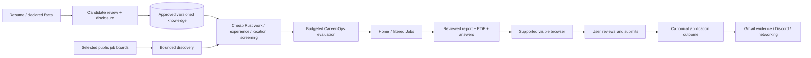
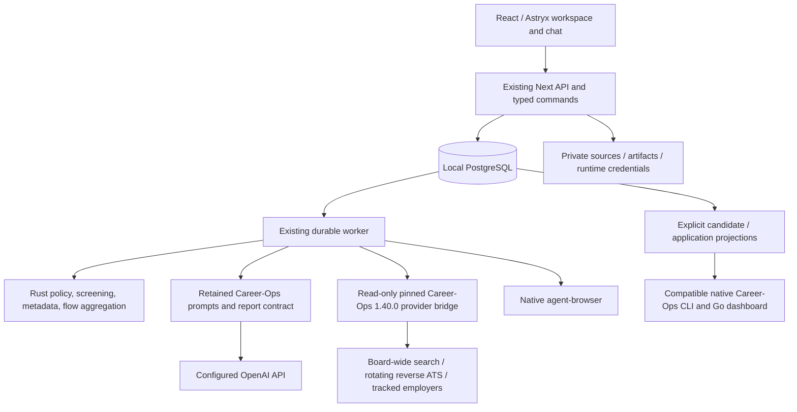
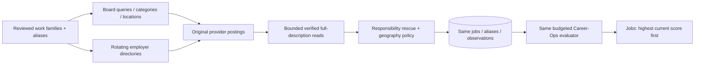
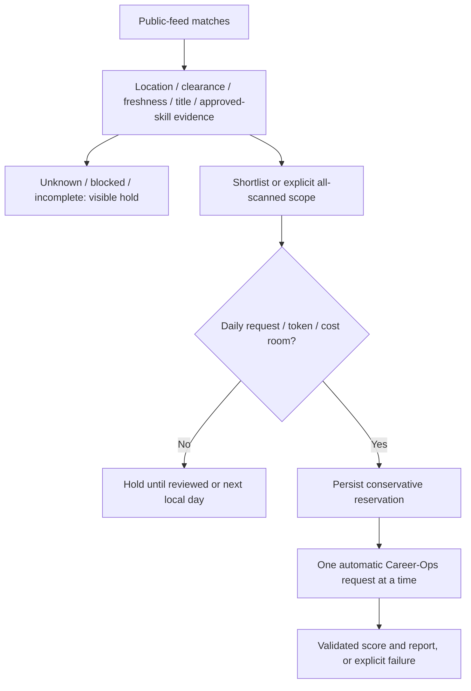
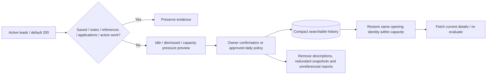
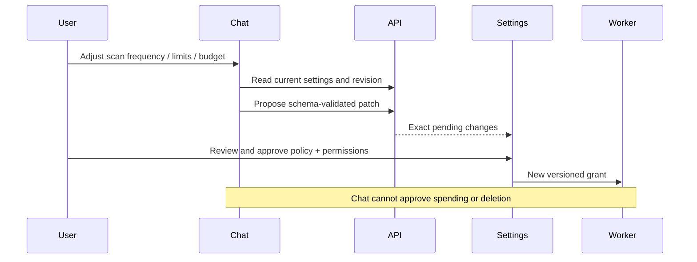

# Maxim Apply

Local-first job discovery and reviewed application preparation, built on Career-Ops.
The workspace remembers approved candidate evidence, finds postings on selected
public boards, and spends a bounded evaluation allowance on a selected shortlist
or the active scanned backlog, according to the owner's reviewed settings.
Career-Ops' **1.0-5.0** result remains the only fit score. Submission is manual.

## Start Here

```powershell
cd "D:\VSC Programs\maxim-apply"
npm run maxim:workspace:install
npm run maxim:workspace:build
npm run maxim:workspace
```

Open **[Maxim Apply](http://127.0.0.1:3010/maxim)**. Obtain your access key locally
with `npm run maxim:workspace:key`; never paste it into chat or Git.
Requires Docker Desktop's Linux engine, Rust/MSVC and the pinned local Node 24.
See the [operating guide](docs/maxim/setup.md) for browser installation and setup.
Stop without deleting data: `npm run maxim:workspace:stop`.

1. **Candidate:** upload authorized sources or enter facts, review/correct them,
   allow professional facts to reach the model if desired, then explicitly activate
   candidate authority. Uploaded text is not automatically approved knowledge.
2. **Settings:** connect an OpenAI API model/key. Review discovery limits and public
   sources. Scheduled scans, automatic paid scoring and cleanup start **off**;
   the automatic monetary allowance starts at **zero**.
3. **Discovery:** review your search profile and enable a source pack. US technology
   searches Built In, Wellfound, Hacker News and the a16z talent network across
   employers. Reverse ATS discovers boards from eight rotating public directories;
   specific Greenhouse/Lever/Ashby employers remain an optional monitoring lane.
   Confirm actual source coverage; installed modules and keyword matches are not
   verified searches or fit scores. [Discovery guide](docs/maxim/upstream-discovery.md).
4. **Home / Jobs:** inspect current high-fit lanes and scores. Filter globally by
   company, industry, role type, location, posting age or current score, and sort
   highest-first. Unknown dates, industry and unevaluated/stale fit remain explicit.
5. **Applications:** create an intent, evaluate/inspect Career-Ops evidence, build
   and approve the exact PDF/report, use supported browser assistance, review the
   form, submit yourself and record the actual outcome.

## One User Journey



## Architecture



No new service, vector store or resident model agent was added. The existing
worker checks due persisted policies once a minute. Missed intervals coalesce.
TypeScript retains authentication, transactions and network I/O; Rust owns pure
domain logic. Migrations 013-018 add the discovery policy, allowance ledger,
compact archive, reviewed search profiles/proposals, per-source inventories and
bounded posting-window cursors. Discovery adopts 153 classified upstream modules;
152 load under the tested bridge, while the executable local parser stays denied.
That is not 153 certified live search engines. Retained scoring/PDF/CLI behavior
is not replaced by a wholesale upstream upgrade.



Discovery receives no candidate facts, API keys or application records in its
provider subprocess. It uses reviewed public retrieval rules and parent-controlled
HTTP with deadlines, byte/request limits and pacing. Trusted pinned-code
containment is tested; it is not an OS network sandbox for arbitrary hostile code.

## Spend Attention And Tokens Selectively



Default limits after owner enablement: 200 active leads, scan every six hours,
three selected boards, 100 processed matches per scan, five evaluations per cycle,
ten per local day and a seven-day posting window. All are bounded settings.
The preselection reasons are **not another fit score**. Approved model-permitted
skill terms support screening; a full posting and canonical candidate knowledge
are still required before evaluation. Failed/ambiguous requests are not silently
repeated. Model pricing must be reviewed for the configured model.

All scanned mode retains the complete active backlog rather than silently applying
shortlist exclusions. Local, experience-compatible work is prioritized within it;
rotating global windows cannot hide the local foreground. Full evidence, consent
and allowances remain required. A highest-ranked T0/T1 is still not a qualified
recommendation. [Experience-level investigation](roadmap/upstream-discovery/fit-audit.md).

```mermaid
stateDiagram-v2
 [*] --> Reserved: Atomic allowance check
 Reserved --> Released: Stopped before dispatch
 Reserved --> Sending: Durable dispatch transition
 Sending --> Settled: Reported token usage
 Sending --> Uncertain: Crash / ambiguous response
 Uncertain --> Uncertain: Keep allowance; no automatic retransmission
```



Automatic allowance is local accounting using owner-entered prices, not a billing
guarantee from the provider. Explicit manual evaluations, chat and other model
tasks are outside that automatic allowance. Pause fences queued work and result
publication; a request already dispatched may still be charged.

## Compact History, Not A Growing Posting Dump



Compact history retains title, company, location, posted/seen/archive dates,
source/URL, source-derived qualifications, historical score/tier, candidate revision
and archive reason. It is a paginated table, not an active lead. Submitted/terminal
application evidence is protected outside the lead slots. At capacity, approved
cleanup can free 10% headroom from unprotected lower-priority leads; current T2+
is not sacrificed just for headroom. Expired raw scan caches are compacted after
seven days by default. Backups and application evidence are not silently erased.
Compaction permits PostgreSQL to reuse space; it does not shrink Docker's Windows
disk file. [Storage maintenance](docs/maxim/storage-maintenance.md).

## Home And Agent Controls

Home contains eight live metrics, a multicolor Sankey over unique recorded
submissions, and up to five unsubmitted role types supported by current fresh T2+
evidence. It does not invent intermediate interview stages, positive fit, vacancy
liveness or missing recommendations. Outcome corrections reset previous stage
evidence. A flow table is available alongside the diagram.



Full contracts, formulas, hold recovery and setup:
[Discovery intelligence](docs/maxim/discovery-intelligence.md).
[Roadmap and stage evidence](roadmap/discovery-intelligence/README.md).
[Implementation status](docs/maxim/implementation_status.md).

## Verification

```powershell
npm run maxim:workspace:test
npm run maxim:native:test
npm run maxim:safety
npm run maxim:privacy
node roadmap/validate-roadmap.mjs
```

The workspace suite covers Rust, app units, real isolated PostgreSQL/provider
fixtures, production build and Chromium journeys. Fixtures do not prove a live
account works. Real automatic spending/cleanup and Gmail/Discord access require
owner setup. Only declared public boards and supported assisted-browser actions
are available; no LinkedIn sending, CAPTCHA bypass or automatic final submission.

## Retained Career-Ops Instructions

The upstream guide below documents the retained native engine. Workspace ownership
gates and the operating guide above take precedence for migrated entities.

> **Maxim Apply workspace:** Start with the [complete operating guide](docs/maxim/setup.md).
> Run `npm run maxim:workspace`; preferred dashboard: http://127.0.0.1:3010/maxim.
> [Roadmap](roadmap/README.md) and [verified S5 evaluation/cutover evidence](roadmap/reviews/s5-evaluation-and-cutover.md).
> Native Career-Ops instructions below remain applicable to the retained engine.
> [Application assistance](docs/maxim/browser-assistance.md), [Gmail](docs/maxim/gmail.md),
> [Discord](docs/maxim/discord.md), [networking](docs/maxim/networking-workspace.md)
> and [current verification limits](roadmap/reviews/mvp-completion-verification.md).
> [Storage usage and safe cleanup](docs/maxim/storage-maintenance.md):
> `npm run maxim:storage`; `npm run maxim:clean` previews only.

[English](README.md) | [Español](README.es.md) | [Português (Brasil)](README.pt-BR.md) | [한국어](README.ko-KR.md) | [日本語](README.ja.md) | [Українська](README.ua.md) | [Русский](README.ru.md) | [繁體中文](README.zh-TW.md)

<p align="center">
  <a href="https://x.com/santifer"></a>
</p>

<p align="center">
  <em>I spent months applying to jobs the hard way. So I engineered the system I wish I had.</em><br>
  Companies use AI to filter candidates. <strong>I just gave candidates AI to <em>choose</em> companies.</strong><br>
  <em>Now it's open source.</em>
</p>

<p align="center">
  
  
  
  
  
  
  
  
  <a href="TRADEMARK.md"></a>
  <a href="https://discord.gg/8pRpHETxa4"></a>
  <br>
  
  
  
  
  
  
  
  
  
</p>

---

<p align="center">
  
</p>

<p align="center"><strong>740+ job listings evaluated · 100+ personalized CVs · 1 dream role landed</strong></p>

<p align="center"><a href="https://discord.gg/8pRpHETxa4"></a></p>

## What Is This

Career-Ops ([career-ops.org](https://career-ops.org), also known as **careerops**) turns any AI coding CLI into a full job search command center. Instead of manually tracking applications in a spreadsheet, you get an AI-powered pipeline that:

- **Evaluates offers** with a structured A-F scoring system (10 weighted dimensions)
- **Generates tailored PDFs** -- ATS-optimized CVs customized per job description
- **Scans portals** automatically (Greenhouse, Ashby, Lever, company pages)
- **Processes in batch** -- evaluate 10+ offers in parallel with sub-agents
- **Tracks everything** in a single source of truth with integrity checks

> **Important: This is NOT a spray-and-pray tool.** Career-ops is a filter -- it helps you find the few offers worth your time out of hundreds. The system strongly recommends against applying to anything scoring below 4.0/5. Your time is valuable, and so is the recruiter's. Always review before submitting.

Career-ops is agentic: Claude Code navigates career pages with Playwright, evaluates fit by reasoning about your CV vs the job description (not keyword matching), and adapts your resume per listing.

> **Heads up: the first evaluations won't be great.** The system doesn't know you yet. Feed it context -- your CV, your career story, your proof points, your preferences, what you're good at, what you want to avoid. The more you nurture it, the better it gets. Think of it as onboarding a new recruiter: the first week they need to learn about you, then they become invaluable.

Built by someone who used it to evaluate 740+ job offers, generate 100+ tailored CVs, and land a Head of Applied AI role. [Read the full case study](https://santifer.io/career-ops-system).

## Features

| Feature                  | Description                                                                                                                              |
| ------------------------ | ---------------------------------------------------------------------------------------------------------------------------------------- |
| **Auto-Pipeline**        | Paste a URL, get a full evaluation + PDF + tracker entry                                                                                 |
| **6-Block Evaluation**   | Role summary, CV match, level strategy, comp research, personalization, interview prep (STAR+R)                                          |
| **Interview Story Bank** | Accumulates STAR+Reflection stories across evaluations -- 5-10 master stories that answer any behavioral question                        |
| **Negotiation Scripts**  | Salary negotiation frameworks, geographic discount pushback, competing offer leverage                                                    |
| **ATS PDF Generation**   | Keyword-injected CVs with Space Grotesk + DM Sans design                                                                                 |
| **Portal Scanner**       | 45+ companies pre-configured (Anthropic, OpenAI, ElevenLabs, Retool, n8n...) + custom queries across Ashby, Greenhouse, Lever, Wellfound |
| **Batch Processing**     | Parallel evaluation with `claude -p` workers                                                                                             |
| **Dashboard TUI**        | Terminal UI to browse, filter, and sort your pipeline                                                                                    |
| **Human-in-the-Loop**    | AI evaluates and recommends, you decide and act. The system never submits an application -- you always have the final call               |
| **Pipeline Integrity**   | Automated merge, dedup, status normalization, health checks                                                                              |

## Quick Start

```bash
# 1. Clone and install
git clone https://github.com/santifer/career-ops.git
cd career-ops && npm install
npx playwright install chromium   # Required for PDF generation

# 2. Check setup
npm run doctor                     # Validates all prerequisites

# 3. Configure
cp config/profile.example.yml config/profile.yml  # Edit with your details
cp templates/portals.example.yml portals.yml       # Customize companies

# 4. Add your CV
# Create cv.md in the project root with your CV in markdown

# 5. Personalize with Claude
claude   # Open Claude Code in this directory

# Then ask Claude to adapt the system to you:
# "Change the archetypes to backend engineering roles"
# "Translate the modes to English"
# "Add these 5 companies to portals.yml"
# "Update my profile with this CV I'm pasting"

# 6. Start using
# Paste a job URL or run /career-ops
```

> **The system is designed to be customized by Claude itself.** Modes, archetypes, scoring weights, negotiation scripts -- just ask Claude to change them. It reads the same files it uses, so it knows exactly what to edit.

See [docs/SETUP.md](docs/SETUP.md) for the full setup guide.

## Gemini CLI Integration

Career-ops supports [Gemini CLI](https://github.com/google-gemini/gemini-cli) natively — the same way it supports Claude Code and OpenCode. All 15 slash commands are available, using the same `modes/*.md` evaluation logic.

### Option A — Native Gemini CLI (Recommended)

```bash
# 1. Install Gemini CLI
npm install -g @google/gemini-cli
# or: npx @google/gemini-cli --version

# 2. Authenticate (free — uses your Google account)
gemini auth

# 3. Run in the career-ops directory
cd career-ops
gemini

# 4. Use slash commands just like Claude Code
/career-ops "Senior AI Engineer at Anthropic..."
/career-ops-evaluate --file ./jds/openai.txt
/career-ops-scan
/career-ops-pdf
/career-ops-tracker
```

The `GEMINI.md` file is auto-loaded as context. All 15 commands are defined in `.gemini/commands/*.toml`.

### Option B — Standalone API Script (No CLI install needed)

```bash
# 1. Get a free API key at https://aistudio.google.com/apikey
cp .env.example .env
# Edit .env → set GEMINI_API_KEY=your_key_here

# 2. Install dependencies
npm install

# 3. Evaluate a job description
node gemini-eval.mjs "We are looking for a Senior AI Engineer..."
node gemini-eval.mjs --file ./jds/my-job.txt
npm run gemini:eval -- "JD text here"
```

> **Free tier:** Both options work without billing. Native CLI uses Google OAuth; the API script uses `gemini-2.5-flash` (15 RPM, 1M tokens/day free).

## Usage

Career-ops is a single slash command with multiple modes:

```
/career-ops                → Show all available commands
/career-ops {paste a JD}   → Full auto-pipeline (evaluate + PDF + tracker)
/career-ops scan           → Scan portals for new offers
/career-ops pdf            → Generate ATS-optimized CV
/career-ops batch          → Batch evaluate multiple offers
/career-ops tracker        → View application status
/career-ops apply          → Fill application forms with AI
/career-ops pipeline       → Process pending URLs
/career-ops contacto       → LinkedIn outreach message
/career-ops deep           → Deep company research
/career-ops training       → Evaluate a course/cert
/career-ops project        → Evaluate a portfolio project
```

Or just paste a job URL or description directly -- career-ops auto-detects it and runs the full pipeline.

## How It Works

```
You paste a job URL or description
        │
        ▼
┌──────────────────┐
│  Archetype       │  Classifies: LLMOps / Agentic / PM / SA / FDE / Transformation
│  Detection       │
└────────┬─────────┘
         │
┌────────▼─────────┐
│  A-F Evaluation  │  Match, gaps, comp research, STAR stories
│  (reads cv.md)   │
└────────┬─────────┘
         │
    ┌────┼────┐
    ▼    ▼    ▼
 Report  PDF  Tracker
  .md   .pdf   .tsv
```

## Pre-configured Portals

The scanner comes with **45+ companies** ready to scan and **19 search queries** across major job boards. Copy `templates/portals.example.yml` to `portals.yml` and add your own:

**AI Labs:** Anthropic, OpenAI, Mistral, Cohere, LangChain, Pinecone
**Voice AI:** ElevenLabs, PolyAI, Parloa, Hume AI, Deepgram, Vapi, Bland AI
**AI Platforms:** Retool, Airtable, Vercel, Temporal, Glean, Arize AI
**Contact Center:** Ada, LivePerson, Sierra, Decagon, Talkdesk, Genesys
**Enterprise:** Salesforce, Twilio, Gong, Dialpad
**LLMOps:** Langfuse, Weights & Biases, Lindy, Cognigy, Speechmatics
**Automation:** n8n, Zapier, Make.com
**European:** Factorial, Attio, Tinybird, Clarity AI, Travelperk

**Job boards searched:** Ashby, Greenhouse, Lever, Wellfound, Workable, RemoteFront

By default `node scan.mjs` (a.k.a. `npm run scan`) trusts what each ATS feed returns. Some companies leave stale postings in their public API even after the role is closed, so those expired entries can leak into `pipeline.md`. Pass `--verify` to launch Playwright after the API pass and drop expired postings before they hit the pipeline:

```bash
node scan.mjs --verify          # zero-token discovery + Playwright liveness check
```

The verification is sequential and only runs against new offers (after dedup), so the cost stays bounded.

## Dashboard TUI

The built-in terminal dashboard lets you browse your pipeline visually:

```bash
cd dashboard
go build -o career-dashboard .
./career-dashboard --path ..
```

Features: 6 filter tabs, 4 sort modes, grouped/flat view, lazy-loaded previews, inline status changes.

## Project Structure

```
career-ops/
├── AGENTS.md                    # Canonical agent instructions (all CLIs)
├── CLAUDE.md                    # Claude Code wrapper (imports AGENTS.md)
├── cv.md                        # Your CV (create this)
├── article-digest.md            # Your proof points (optional)
├── config/
│   └── profile.example.yml      # Template for your profile
├── modes/                       # 14 skill modes
│   ├── _shared.md               # Shared context (customize this)
│   ├── oferta.md                # Single evaluation
│   ├── pdf.md                   # PDF generation
│   ├── scan.md                  # Portal scanner
│   ├── batch.md                 # Batch processing
│   └── ...
├── templates/
│   ├── cv-template.html         # ATS-optimized CV template
│   ├── portals.example.yml      # Scanner config template
│   └── states.yml               # Canonical statuses
├── batch/
│   ├── batch-prompt.md          # Self-contained worker prompt
│   └── batch-runner.sh          # Orchestrator script
├── dashboard/                   # Go TUI pipeline viewer
├── data/                        # Your tracking data (gitignored)
├── reports/                     # Evaluation reports (gitignored)
├── output/                      # Generated PDFs (gitignored)
├── fonts/                       # Space Grotesk + DM Sans
├── docs/                        # Setup, customization, architecture
└── examples/                    # Sample CV, report, proof points
```

## Tech Stack


- **Agent**: Claude Code with custom skills and modes
- **PDF**: Playwright/Puppeteer + HTML template
- **Scanner**: Playwright + Greenhouse API + WebSearch
- **Dashboard**: Go + Bubble Tea + Lipgloss (Catppuccin Mocha theme)
- **Data**: Markdown tables + YAML config + TSV batch files

## Also Open Source

- **[cv-santiago](https://github.com/santifer/cv-santiago)** -- The portfolio website (santifer.io) with AI chatbot, LLMOps dashboard, and case studies. If you need a portfolio to showcase alongside your job search, fork it and make it yours.

## About the Author

I'm Santiago -- Head of Applied AI, former founder (built and sold a business that still runs with my name on it). I built career-ops to manage my own job search. It worked: I used it to land my current role.

My portfolio and other open source projects → [santifer.io](https://santifer.io)

## Star History

<a href="https://www.star-history.com/?repos=santifer%2Fcareer-ops&type=timeline&legend=top-left">
 <picture>
   <source media="(prefers-color-scheme: dark)" srcset="https://api.star-history.com/chart?repos=santifer/career-ops&type=timeline&theme=dark&legend=top-left" />
   <source media="(prefers-color-scheme: light)" srcset="https://api.star-history.com/chart?repos=santifer/career-ops&type=timeline&legend=top-left" />
   
 </picture>
</a>

## Disclaimer

**career-ops is a local, open-source tool — NOT a hosted service.** By using this software, you acknowledge:

1. **You control your data.** Your CV, contact info, and personal data stay on your machine and are sent directly to the AI provider you choose (Anthropic, OpenAI, etc.). We do not collect, store, or have access to any of your data.
2. **You control the AI.** The default prompts instruct the AI not to auto-submit applications, but AI models can behave unpredictably. If you modify the prompts or use different models, you do so at your own risk. **Always review AI-generated content for accuracy before submitting.**
3. **You comply with third-party ToS.** You must use this tool in accordance with the Terms of Service of the career portals you interact with (Greenhouse, Lever, Workday, LinkedIn, etc.). Do not use this tool to spam employers or overwhelm ATS systems.
4. **No guarantees.** Evaluations are recommendations, not truth. AI models may hallucinate skills or experience. The authors are not liable for employment outcomes, rejected applications, account restrictions, or any other consequences.

See [LEGAL_DISCLAIMER.md](LEGAL_DISCLAIMER.md) for full details. This software is provided under the [MIT License](LICENSE) "as is", without warranty of any kind.

## Contributors

<a href="https://github.com/santifer/career-ops/graphs/contributors">
  
</a>

Got hired using career-ops? [Share your story!](https://github.com/santifer/career-ops/issues/new?template=i-got-hired.yml)

## License & Trademark

The code is licensed under [MIT](LICENSE). The "career-ops" name and
brand are governed by the [Trademark Policy](TRADEMARK.md) — permissive
for community use, reserved for commercial product naming and
endorsement.

## Let's Connect

[](https://santifer.io)
[](https://linkedin.com/in/santifer)
[](https://x.com/santifer)
[](https://discord.gg/8pRpHETxa4)
[](mailto:hi@santifer.io)
