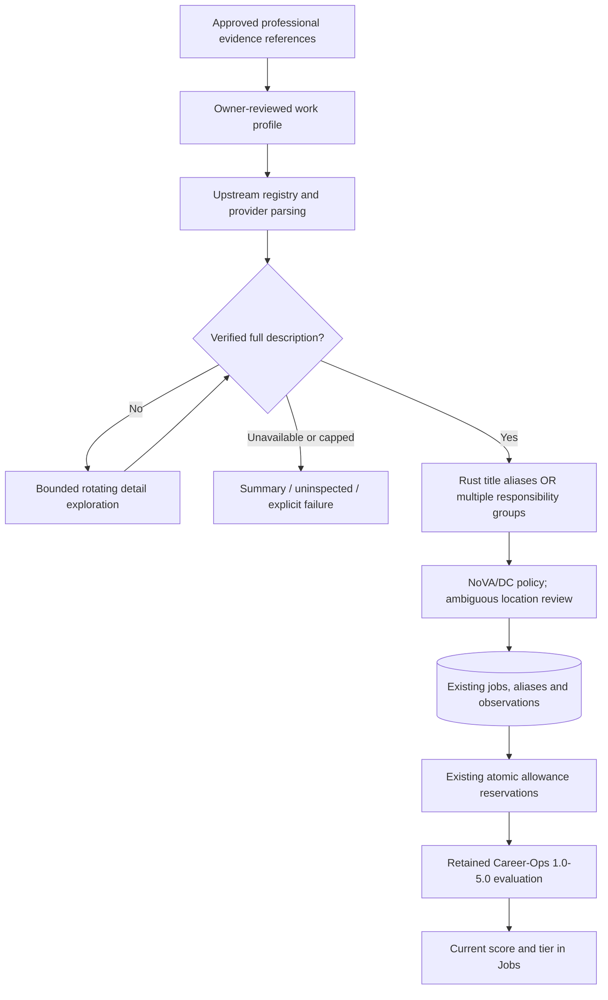
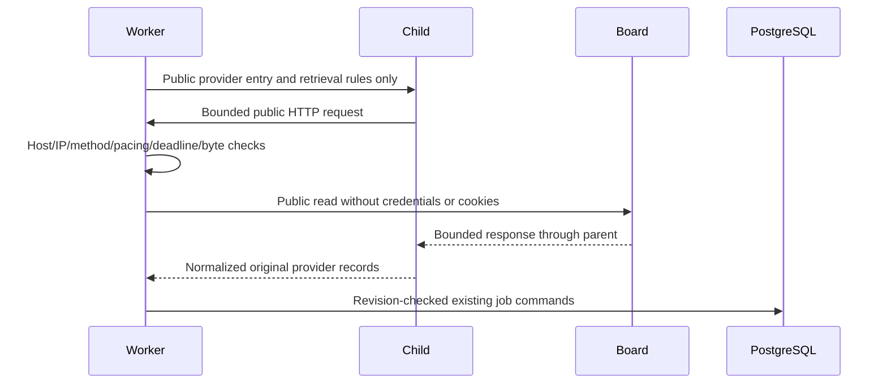

# Upstream-Native Job Discovery

Implemented 2026-11-21. [Delivery roadmap](../../roadmap/upstream-discovery/README.md)
and [measured verification](../../roadmap/upstream-discovery/verification.md).

## Use It

1. Start with `npm run maxim:workspace` from the repository root. Open
   [Discovery](http://127.0.0.1:3010/maxim?view=discovery). Obtain the private
   sign-in key with `npm run maxim:workspace:key` if necessary.
2. In Broad market setup, review work families, target experience levels, aliases, exclusions and
   exploration limits. Save the search profile. It references current approved
   professional evidence, not raw uploads. Candidate changes require re-review.
3. Enable US technology or Reverse ATS. This creates source entries, not new
   candidate claims or authorization for spending/scheduling. Remote is optional;
   remote-only/ambiguous locations are held unless explicitly included for review.
4. Select a source pack or individual enabled sources and Search jobs. A source
   in cooldown must wait. Use separate runs to give each board its own request
   allowance. Search history contains actual source attempts and coverage details.
5. Open [Jobs sorted by score](http://127.0.0.1:3010/maxim?view=jobs&sort=score_desc).
   Full descriptions are needed before evaluation. Fetch full posting refreshes
   supported summaries from their known source; unavailable/restricted pages stay
   held. Original posting and Application page retain publisher/destination links.
6. In Settings, review automatic scoring, prices and daily request/token/USD
   limits. Choose Shortlist for selective screening or All scanned roles for the
   active discovered backlog. Approve explicitly. Run a cycle or let the existing
   worker process due cycles. A source pack never increases that allowance.
7. Inspect the score, report, current policy and requirements before applying.
   Create an application intent, approve the exact packet and use supported visible
   browser assistance. Submit manually. Discovery does not add universal form support.

The agent can read the search profile, propose changes for separate owner approval,
and start a bounded market search on an explicit current request. Example:
"Find broad-market software delivery and integration jobs around NoVA/DC."
"Score all scanned jobs" prepares the existing scoring setup; it is not an
unlimited paid command. Failed/held evaluations are not silently retried.

## Search Scope

| Lane | Implemented sources | Important limit |
| --- | --- | --- |
| US technology | Built In, Wellfound, Hacker News Who Is Hiring, a16z speedrun talent | Board queries/categories/locations, not every posting on the web |
| Optional remote | Himalayas, Remotive, RemoteOK, Jobicy, Working Nomads, We Work Remotely | No automatic NoVA eligibility; source access can fail |
| Reverse ATS | Greenhouse, Lever, Ashby, Workday, iCIMS, BambooHR, Paylocity, join.com | Public inventories, four rotating tenants per source run; stale/dead tenants possible |
| Deferred large feed | Workable | Not enabled: global feed needs a separate tested streaming/resource budget |
| Employer monitoring | Existing configured employer feeds and available catalog adapters | Optional; not a prerequisite for board-wide admission |

The catalog includes all 153 upstream non-helper provider modules. 152 can load
inside the tested bridge; executable local-parser support remains denied. Some
entries are regional, single-employer, unavailable or retired. Installed, enabled,
runtime-tested, partial and successful are separate facts. There is no unrestricted
LinkedIn, Indeed, Glassdoor, Dice or hiring.cafe search. No new market API account
or paid search subscription is required for the enabled public packs.

Built In uses Washington DC engineering categories and bounded junior/Engineer II
queries for early/mid targets. Its broad category remains an exploration lane.
Wellfound uses Washington DC discovery,
without a narrow title-only query. a16z uses its documented DC metro and broad
technical/customer/operations function filters. Its age filter rounds the configured
window outwards to 24 hours, seven days or 30 days; over 30 days adds no server age
filter. Its `q` matches title/company/location, not a guaranteed description search.
Hacker News comments are hiring evidence, not certified full job descriptions.

## How A Novel Title Reaches A Real Score

Work matching is explained retrieval logic, not a second fit score. Generic words
such as engineer or Git do not rescue an unrelated title. Full evidence comes from
native full-body feeds, known ATS JSON or unambiguous employer/title-matching
JobPosting JSON-LD. Long arbitrary page text does not prove completeness. a16z
detail checks open status, title, employer and identity before using its full body
and actual application destination. Active-clearance blockers remain blockers.

Current scores require matching candidate/posting revisions, engine hash, policy
review and valid fact dependencies. Changing those inputs makes the old result
historical, not zero. Recheck saved report only revalidates an existing report/hash;
it cannot revise a genuine model disagreement or silently purchase another report.

Target experience levels come from reviewed preferences, not an invented count of
years. Explicit Senior/Staff/management mismatches are filtered from new discovery;
generic titles remain uncertain. Review the full requirements. Original saved
senior jobs and historical scores are not automatically deleted. All scanned
scoring retains its scope but prefers compatible levels and local complete jobs,
including a bounded local foreground alongside rotating global windows.

Disclose roles/levels separately in Candidate if the evaluator should use them.
Do not enable an entire personal source containing unrelated fields just to expose
two preferences. The native target-role/archetype projection includes only approved
model-disclosable values. Changing consent invalidates old current scores.

## Resource And Authority Boundaries

- One existing durable worker and PostgreSQL store; no resident LLM scanner.
- Default run: up to ten sources, two provider pages, 18 HTTP requests total,
  12 per source, 20 MiB total response bytes, 5 MiB per response, 85-second worker
  deadline and host pacing of at least 1.1 seconds. Manual detail refresh: one read.
- Provider child: 192 MiB heap, 80-second deadline, 8 MiB result bound, sanitized
  environment, explicit filesystem roots and denied writes/process spawning.
- Only audited Workday search POSTs and the exact pinned join PublicJobsList query
  with bounded variables are allowed. No arbitrary GraphQL, application POSTs,
  credentials, challenges, proxy rotation or browser execution in discovery.
- Inventories expire after 24 hours; cache at most 5 MiB of normalized entries.
  Provider windows return at most 500 jobs per invocation and persist rotation.
  Per-source posting cursor maps retain at most 200 tenant keys.
- Raw page/feed bodies are not stored. Keep compact observations/provenance,
  admitted descriptions and existing protected application/history evidence.
- This contains trusted pinned provider code; Node filesystem permissions and
  module hooks are not an OS network sandbox for arbitrary malicious JavaScript.
- Existing default capacity is 200; the owner's current override is 600. New
  over-capacity discoveries are held rather than deleting protected history.
- Existing candidate/application ownership gates, native CLI, scoring prompts,
  PDF generation and manual submission are preserved. Discovery alone is pinned
  to Career-Ops 1.40.0; this is not a full upgrade of the retained 1.8.1 engine.

## Diagnose An Incomplete Run

Search history distinguishes returned jobs, admitted jobs, employers, HTTP requests,
missing descriptions, uninspected jobs and uninspected tenants. Coverage details
show inventory timestamps/cursors, public filters, title rescues, location holds,
tenant failures and resource caps. Partial is not an empty result or proof that no
more matching jobs exist. Provider catalog presence is not live certification.

| State | Action |
| --- | --- |
| Profile stale | Review current Candidate evidence, then save the updated search profile |
| Capacity hold | Archive unneeded unprotected leads or review the active limit in Settings |
| Summary / missing body | Fetch full posting; inspect a source failure rather than scoring a teaser |
| Posting expired | The publisher's structured expiry is past; verify the original posting before treating it as current |
| Location review | Verify actual NoVA/DC eligibility; do not assume worldwide remote is acceptable |
| Source quota/challenge | Wait for the recorded retry time or disable the source; no bypass |
| Dead tenant / schema drift | Inspect the receipt, retain attribution and use a supported manual posting fallback |
| Score review required | Inspect the report; use local Recheck only for formatting validation, not substantive conflict |
| Cost/token/request hold | Wait for the next local day or explicitly review settings; chat cannot approve increases |

## Maintain And Test

From the repository root, run `npm run maxim:workspace:test`,
`npm run maxim:native:test`, `npm run maxim:test`, `npm run maxim:safety` and
`npm run maxim:privacy`. The workspace suite includes Rust, units, real isolated
PostgreSQL integration and Chromium desktop/mobile journeys. Test data never uses
production credentials. Native compatibility fixtures are not a live source audit.

Pinned files, license and SHA-256 inventory live in
`maxim/vendor/career-ops-discovery/`. The narrow bridge and generated capability
manifest live in `maxim/upstream-discovery/`. Update source pins deliberately with
`vendor.mjs`, regenerate `catalog.mjs --write`, audit the changed transports and
rerun boundary/integration/safety tests. Do not edit a vendored source to hide drift.
