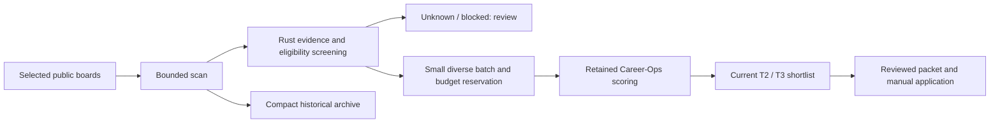
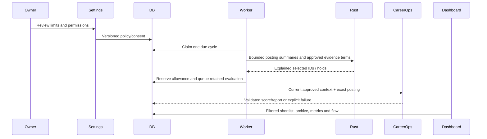

# Discovery Intelligence Roadmap
Date: 2026-11-20. Authority: current owner requirements, then the existing manifesto.
This extends the deployed app and retained Career-Ops engine, not a second CRM.

## 1. Product And Flow
Deliver a small, fresh, evidence-scored shortlist, not hundreds of keyword matches.
A durable timer is not a continuously running agent. Rust performs cheap explained
screening; a bounded subset reaches Career-Ops, still the only 1.0-5.0 fit score.
Final application submission and outreach remain manual.

> **Comments**
> Add feedback here. Original MVP comments are unchanged.

## 2. Delivery Stages
| Stage | Deliverable | Standing |
| --- | --- | --- |
| [0 Baseline](stages/00-baseline.md) | Push current work, main merge, new branch | Complete: origin/main 2c7031e |
| [1 Policy](stages/01-policy.md) | Versioned settings, pure Rust screening | Complete: 09c4b41; final Rust/policy regression passed |
| [2 Orchestration](stages/02-orchestration.md) | Bounded durable scan/evaluation timing and reservations | Complete: b8f1152; budget, recovery, rotation and guard regression passed |
| [3 Retention](stages/03-retention.md) | Capacity, compact archive, preview and restore | Complete: 50c1249; protection, expiry, preview and restore regression passed |
| [4 Workspace](stages/04-workspace.md) | Global filters, archive, settings and agent proposals | Complete: e95c837; global filters, proposals and desktop/mobile journeys passed |
| [5 Home](stages/05-home.md) | Sankey, eight metrics, top lanes, real README and proof | Complete: Home/hardening stage commit; 143 integration and 37 Chromium tests passed |

Each stage has its own commit. New work remains on maxim/discovery-intelligence;
this roadmap does not authorize a later merge of unverified changes.
The [verification receipt](reviews/verification.md) records exact suites, limits
and the owner-controlled live gates. Completion does not enable production spend
or deletion and does not promote unrelated original MVP gates.

> **Comments**
> Add feedback here.

## 3. Defaults And Boundaries
- Reuse PostgreSQL, existing work leases, commands and private artifacts. Rust owns
  pure screening, source-derived qualifications and lane classification. TypeScript
  owns existing authentication, I/O and orchestration. No new service/daemon.
- Scheduled scans, paid automatic scoring and destructive cleanup initially OFF.
  Deployment does not spend money or delete production job details.
- Default active-lead capacity 200, configurable 20-2000. Saved/pinned records,
  applications/packets, user notes, references and active work are protected, but
  count toward capacity while still unsubmitted. Submitted/terminal applications
  retain their evidence outside the active-lead slots. If protection exceeds capacity, hold ingestion and report
  the overage; never erase evidence to pretend the limit was met.
- Once enabled: scan every six hours, three boards maximum per run from an owner-
  selected rotation pool (up to 200), 100 matching
  postings processed per cycle. Existing request/page/byte/time/pacing limits
  remain. This limits processed matches, not a vendor's feed size. Coalesce missed
  schedules rather than replaying an offline backlog.
- Score at most five openings per cycle, ten per day, one request at a time.
  Default posting window seven days; unknown dates require review unless admitted.
  Require a full current description, canonical approved candidate context and no
  hard policy blocker. Cache by candidate/posting/engine/model/API identity.
- Preselection is queue ordering, not another fit score. Return categorical
  inclusion/exclusion and evidence terms. Prefer fresh, target-role/evidence matches
  and verified priority; spread employers and reserve one in five slots for other
  eligible leads to avoid a closed feedback loop. Failed requests need explicit
  retry, not another hidden charge.
- Daily local spending allowance defaults to zero. Owner-reviewed input/output
  prices per million tokens must match the model. Reserve conservatively before
  transmission; uncertain requests keep their reservation. Token and request caps
  remain hard local bounds; monetary estimates are not a provider billing guarantee.
- Keep compact title/company/source identity/URL, posted/first/last seen dates,
  location, source-derived qualifications (4000 characters maximum), score/tier,
  current-at-archive state, candidate revision and archive reason/time. Unknown
  dates/qualifications remain unknown. Compact history is retained by default.
- Seven-day bulky-data retention after owner enablement. Archive before clearing
  unprotected descriptions, raw provider payloads and unreferenced report material.
  Submitted evidence, protected records and backups are not silently purged.
  Retain opening identity so rescans do not create duplicates. Restore needs
  capacity and current posting details; it does not resurrect an approved packet.
- Filters are applied in SQL before pagination: company, industry (manual source
  metadata/provenance or Unknown), role lane, location, posted today/7/30 days,
  current score range and evaluated/unscored. Preserve selection/filters in URLs.
- Chat reads settings and proposes schema-validated changes. The owner reviews the
  exact proposal/revision in Settings. The model cannot approve its own proposal,
  grant spending/deletion consent or secretly raise budgets.
- Home recommendations: up to five actual role lanes backed by current T2+,
  unsubmitted openings. No padding with fictional recommendations. Eight stats
  maximum. Sankey counts unique confirmed submissions and recorded response,
  interview and offer evidence; do not invent task or final-round stages.

> **Comments**
> These are safe implementation assumptions, not permission to bill or prune.

## 4. Shared Contracts

Migrations 013-015 add policy, cycles/selection receipts, spend reservations, compact
archive, settings proposals, per-source cursors and revision-bound job holds.
Factor narrow queue functions from the existing
scan/evaluation command handlers: no impersonated browser login or reusable worker
credential. Background work rechecks its explicit settings/candidate/model grant
immediately before transport. Pause/revoke fences queued work.

Read interfaces: policy/status/preview, filtered jobs, archive and Home.
Commands: save policy, request bounded cycle, preview/apply cleanup, restore role,
propose/approve/reject policy changes. Existing APIs remain compatible and scoped.
No fallback mock data, second score, hosted candidate memory or application sends.

> **Comments**
> Add interface feedback here.

## 5. Validation And Review
Use installed EGM drift-report on this directory and separate fresh-context design
and implementation-readiness audits using source-only allowlists. Record failed
reviewers as not run. These autonomous audits are not a formally gate-approved or
converged EGM loop; owner approvals remain real UI decisions.

Prove policy boundaries, diversity, empty/unknown data, concurrent reservations,
changed consent/model/candidate, crash uncertainty, no catch-up storm, protected
capacity, payload reduction, archive/dedupe/restore, global filters, mobile layouts,
actual cohort/time semantics, Sankey conservation and no invented progress.
Use isolated source/provider fixtures, not private credentials. Record tests per
stage. Preserve retained native tests and actual manual-application boundaries.
The [case/evidence matrix](reviews/verification.md) maps eighteen regression
contracts to actual unit, integration, browser and compatibility suites.
Root README must describe shipped behavior, with data/worker/retention/journey
diagrams. Do not promote original MVP live gates merely because fixtures pass.

> **Comments**
> Additional ideas need a user benefit, cost and clear acceptance test.

