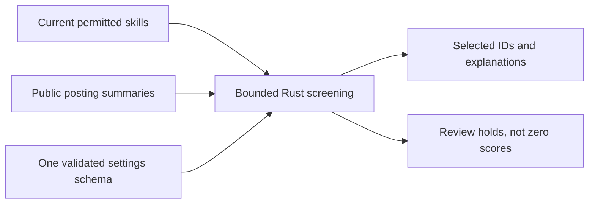

# Settings And Rust Screening

## Intent
Persist settings and pure shortlist rules.

## Contract
One workspace policy/revision. Bounded public summaries and current approved standard evidence terms only. Explain selection; do not label a heuristic as fit.

## Scope And Interfaces
- Persist a versioned `discovery_policies` record, disabled by default. Defaults
  live in one strict schema, not duplicated browser/model constants.
- Keep capacity (200 by default), cycle/day/token/cost ceilings, posting-age and
  title/evidence settings bounded. A pool of at most 200 public sources rotates
  one to three boards per run; the native one-run interface stays capped at three.
- Rust `screen_jobs` accepts at most 200 byte-bounded posting summaries and
  approved standard/model-permitted `skills.*` terms. It returns IDs, categorical
  evidence/reasons and holds, never a competing numeric fit score.
- Rust `job_metadata` classifies title lanes and retains at most 4,000 characters
  of actual qualification text. Missing evidence stays unknown.
- Existing tier routing and NoVA/DC/salary/clearance policy remain authoritative.

## Handoff
Inputs: existing job identities, approved facts, policy flags and retained fit
freshness. Outputs: strict policy type and pure Rust shortlist/metadata operations
consumed by Stage 2. No model, filesystem deletion or new external account.

See the [roadmap](../README.md) for defaults, interfaces and authority. Extend only
the existing service boundaries; preserve Career-Ops and approved data contracts.

## Acceptance And Handoff
Rust and unit tests cover bounds, empty input, blockers, unknown dates, matches and diversity.

Initial receipt: commit `09c4b41`, 34 Rust tests and two policy tests passed.
Later Stage 5 hardening adds Unicode input packing, cumulative small-batch
exploration and long qualification-paragraph tests. Final counts are in the
[verification record](../reviews/verification.md).

Commit each stage after checks. Update standing from actual evidence, not planned
tests or an account integration that remains disabled.

> **Comments**
> Add stage-specific feedback and findings here.
