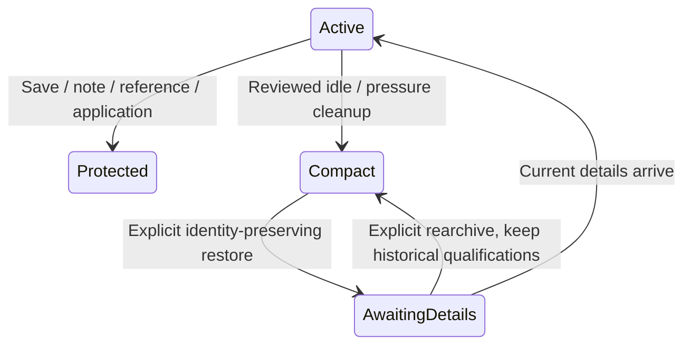

# Compact Archive And Capacity

## Intent
Protect evidence while bounding live leads and bulky payloads.

## Contract
Capacity counts active unsubmitted leads; a non-default outcome alone is not proof
of submission. Unknown/responded drafts without a submission date still count.
Confirmed submissions and explicit terminal states remain protected history.

## Lifecycle And Storage
Inputs are canonical jobs, source observations, evaluations/artifact references,
application history and the Stage 1 policy. Output is `job_archive`, a compact
searchable record plus a stable opening stub. No native tracker is rewritten.

Preview binds policy, selected revisions, protection, active work and capacity.
Apply recomputes under the same lock order used by relevant writers. Saved jobs,
notes, references, applications/packets and active work cannot be silently removed.
At capacity, approved cleanup can target 10% headroom from lower-priority leads;
current T2+ is not evicted for headroom alone. Overprotection produces a hold.

Expire large provider page caches separately. Live leads retain compact normalized
salary/secondary-location inputs used by `jobPolicy`; removing old feed bodies
must not change eligibility. Fully compacted jobs lose duplicate prompt/posting/
observation payloads and unreferenced reports, not their historical identity/score.

Restore consumes capacity but does not falsify last-seen freshness. Awaiting-detail
restores are excluded from automatic recompaction; deliberate rearchive preserves
their last known qualifications until actual replacement evidence arrives.
Compaction runs at most 50 jobs / 20 old runs per batch. Physical Docker disk
shrinking and backup expiry remain separate managed operations.
Preview first. Capture compact telemetry before removing details. Protect pins, notes, applications/packets, references and active work. Preserve original identities; restore does not reapprove old packets.

See the [roadmap](../README.md) for defaults, interfaces and authority. Extend only
the existing service boundaries; preserve Career-Ops and approved data contracts.

## Acceptance And Handoff
Implemented owner-previewed compaction (50 records / 20 old runs per batch),
an opt-in daily sweep, protected-note/save/reference/application exclusions and
active-work fencing. Stable opening stubs prevent automatic rehydration. Compact
history is paginated and restorable; restored descriptions/scores require fresh
evidence. Manual creation and scanner ingestion respect the saved capacity policy.
Submitted application history is protected outside the lead limit.

Evidence: production build and isolated retention integration passed, including
save-after-preview invalidation, cross-workspace isolation, compact qualifications,
identity-preserving restore and active-work hold. No production cleanup was run.

Prove cap backpressure, protected survival, actual payload reduction, idempotent cleanup, exact history and restore/dedupe.

Commit each stage after checks. Update standing from actual evidence, not planned
tests or an account integration that remains disabled.

> **Comments**
> Add stage-specific feedback and findings here.
