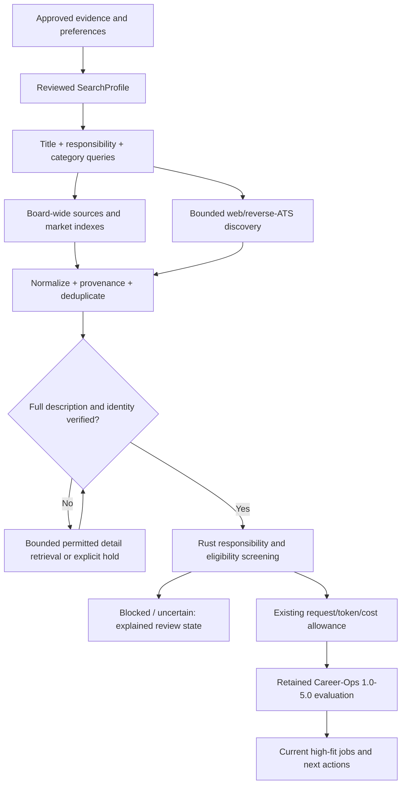

# Market-Wide Discovery And Responsibility-Based Search

Design update: the owner rejected the connector-pilot approach. The source audit
below remains evidence; the replacement proposal is
[Upstream-Native Discovery](upstream-discovery-design.md). Sections 3 and 10 below
are earlier proposals, not the current implementation direction.

Date: 2026-11-21. Status: research and proposed direction, not an approved
implementation roadmap. Branch: `maxim/source-discovery-expansion`.
Local baseline: `064a598`, retaining Career-Ops package version 1.8.1.
Upstream inspected: Career-Ops 1.40.0 at
`194933aa111aa4f2fd3ffa69048347fa6a974d27`.

## 1. Finding And Corrected Product Goal

Increasing the company watchlist does not solve market discovery. The product
must find relevant openings at employers the candidate has never named. Employer
tracking is an optional monitoring lane, not a prerequisite for admission.

The previous count of 224 enabled employer targets and 12 saved queries describes
configuration, not market coverage. Likewise, nine attempted employer feeds do
not mean nine market-wide job boards were searched. Count distinct employers and
verified openings actually returned, not configured entries or installed modules.

The accepted problem is:

> Find fresh openings across job boards and the wider job market where the
> candidate has evidence of doing the actual work, including unfamiliar titles
> and employers. Verify the posting, then use Career-Ops to assess fit.

Research did not activate new sources, change the scoring budget, install
upstream, or ingest the online examples into the application database.

> **Comments:** Add corrections or scope decisions here.

## 2. What Career-Ops Actually Provides

There are three materially different systems to distinguish:

| System | Verified scope | Limitation |
| --- | --- | --- |
| Maxim's current dashboard | `supported=['greenhouse','lever','ashby']`; explicit employer board slugs | No board-wide search provider; no execution of saved web searches |
| Retained local Career-Ops 1.8.1 | Seven provider modules: Ashby, Greenhouse, Lever, local parser, Recruitee, SmartRecruiters, Workable; `scan.mjs` loops configured employers | Broader browser and web-search steps live in agent instructions, not a scheduled search engine |
| Current upstream 1.40.0 | 153 non-helper provider modules, `job_boards` execution, board-wide connectors, reverse ATS discovery and richer filters | Module presence is not 153 verified working market-search integrations; some are single-employer, regional, restricted or retired |

Upstream has moved from `santifer/career-ops` to `career-ops-hq/career-ops`.
This was verified through the redirect and the upstream Git remote, not inferred
from stale local documentation. No remote URL or local dependency was changed.

### Board-Wide Discovery Exists In Current Upstream

`scan.mjs` reads `config.job_boards` as well as `tracked_companies`. Examples
include Built In, Wellfound board-search pages, Himalayas, Jobicy, Remotive,
RemoteOK, Working Nomads, We Work Remotely and Hacker News hiring threads.
These sources can return multiple employers without a manually curated list.
Most remote boards are supplementary for a NoVA/DC search, not automatically
eligible just because a result is marked remote.

Concrete source inspection:

- Built In has an explicit board-wide provider with query/category paging and
  optional location/salary enrichment. Its initial description can be a short
  excerpt, so this is not automatically sufficient for evaluation.
- Wellfound has separate company and board modes. Board mode accepts role and/or
  location searches and may need bounded company-page expansion because search
  pages highlight only some jobs per employer.
- Remote feeds differ in freshness, restrictions and application-link rules;
  they are not interchangeable unrestricted databases.

### Reverse ATS Discovery Also Exists

Upstream `scan-ats-full.mjs` discovers tenants from public ATS directories and
then scans their postings. Its documented sources include Greenhouse, Lever,
Ashby, Workday, iCIMS, BambooHR, Paylocity, join.com and Workable. This discovers
unknown employers, unlike importing another fixed watchlist.

It still makes employer/tenant-level requests under the hood. It is a useful
long-tail supplement, not a substitute for efficient board-wide query services.
Do not run its all-tenants defaults inside Maxim without caps. Its Workable
path describes a roughly 140 MB compressed feed: that conflicts with a small
local-first deployment unless explicitly justified and streamed with limits.

### Title Matching Is Still A Real Upstream Limitation

Current `scan.mjs` supports `content_filter.rescue_title_misses`: an opening that
misses positive title keywords can survive on configured description traits.
This is opt-in, requires usable description text and does not override explicit
negative-title gates. It is lexical trait matching, not proof of competitiveness.

Crucially, current `scan-ats-full.mjs` explicitly warns that it **ignores** that
option. It prechecks board titles before downloading descriptions. Importing the
reverse scanner alone would therefore preserve the exact failure the owner
identified: relevant work under unexpected titles can disappear before scoring.
Undated postings are also omitted by default there; an explicit option admits
them. Never equate these defaults with exhaustive market coverage.

Sources, pinned to the inspected revision:

- [Provider catalog](https://github.com/career-ops-hq/career-ops/blob/194933aa111aa4f2fd3ffa69048347fa6a974d27/docs/SUPPORTED_JOB_BOARDS.md)
- [Scanner implementation](https://github.com/career-ops-hq/career-ops/blob/194933aa111aa4f2fd3ffa69048347fa6a974d27/scan.mjs)
- [Reverse scanner and title-rescue warning](https://github.com/career-ops-hq/career-ops/blob/194933aa111aa4f2fd3ffa69048347fa6a974d27/scan-ats-full.mjs#L1043)
- [Built In provider](https://github.com/career-ops-hq/career-ops/blob/194933aa111aa4f2fd3ffa69048347fa6a974d27/providers/builtin.mjs)
- [Wellfound provider](https://github.com/career-ops-hq/career-ops/blob/194933aa111aa4f2fd3ffa69048347fa6a974d27/providers/wellfound.mjs)

> **Comments:** Add upstream components or compatibility concerns here.

## 3. Where Maxim Should Search

Use a small set of distinct retrieval channels, each accepting a search profile,
not requiring an employer name. Do not implement every source at once.

| Channel | Proposed role | Constraint / decision |
| --- | --- | --- |
| Built In and Wellfound | First board-wide upstream reuse candidates for US technology/startup openings | Test actual NoVA/DC coverage, accessible pages, description completeness and publisher rules before marking supported |
| One cross-employer index | Primary broad-market pilot; compare TheirStack and Adzuna on the same candidate queries | Account, coverage, cost, retention and license must be approved; choose one based on measured results |
| USAJOBS Search API | Optional federal search across agencies by occupation, keywords and location | Needs key and registered contact; federal eligibility and application-material requirements remain separate |
| Licensed web-search API | Supplement for unfamiliar titles, smaller boards and employer-hosted postings absent from the main index | Search results are leads, not verified openings; storage rights and page-fetch permissions are separate |
| Bounded reverse ATS discovery | Rotating long-tail discovery outside known employers | Catalog sampling, request/time/byte caps and title-miss exploration required; no full-market mirror |
| Remote boards | Optional US-location-compatible opportunities | Remote does not mean worldwide, NoVA-compatible or allowed by current preferences; explicit geographic checks |
| Existing employer watchlist | Monitor companies the owner particularly values | Supplemental; never the admission boundary for the main search |

### Cross-Employer API Findings

**TheirStack** exposes job-description phrase/word filters, technology, location
and recency filters. This directly addresses responsibility-led retrieval. Its
description filter can match any supplied phrase; the API does not expose the
same simple AND filter for every combination. Recheck trait combinations locally.
Its credit economics must be measured before choosing it for a personal tool.
[API documentation](https://theirstack.com/en/docs/api-reference/jobs/search_jobs_v1),
[pricing](https://theirstack.com/en/pricing).

**Adzuna** offers keyword/location/category job search with an app ID/key. Its
search documentation explicitly says descriptions are snippets. It can find
unknown employers but does not eliminate description acquisition. Preserve its
source credit, distinguish estimated salary from posted salary, and resolve the
permitted detail/application flow before implementing enrichment. Personal search
and a commercial/public product can have different terms.
[Search](https://developer.adzuna.com/docs/search),
[access](https://developer.adzuna.com/overview),
[terms](https://developer.adzuna.com/docs/terms_of_service).

**USAJOBS** supports keywords across announcements, geographic/radius filters,
occupation categories, dates and eligibility filters. It is an actual searchable
board API, not an employer list. Normalize radius results locally because a DC
radius also reaches Maryland. Do not map clearance eligibility to active
clearance, or assume a current resume satisfies every federal announcement.
[Search API](https://developer.usajobs.gov/api-reference/get-api-search).

**Brave Search** documents site/body query operators and freshness controls.
These make cross-domain and responsibility-led queries possible. Index freshness
does not establish an opening's posted date. Persisting search results requires
an appropriate plan; that plan does not grant rights to third-party pages.
[Operators](https://api-dashboard.search.brave.com/documentation/resources/search-operators),
[API and storage-rights information](https://brave.com/search/api/).

**JSearch** is a third-party Google-for-Jobs/web data service that advertises
multiple publishers and application destinations. It is not Google's official
job-search API or an official unrestricted LinkedIn/Indeed integration. Treat
coverage, data rights, provenance and commercial terms as pilot gates rather
than assuming its marketing means complete authorized coverage.
[Vendor documentation](https://www.openwebninja.com/api/jsearch).

### Do Not Promise Unrestricted LinkedIn Or Indeed Access

LinkedIn's published rules restrict unauthorized scraping/automation; its
documented Talent job-posting integrations require approved partner access.
Posting APIs are not a general job-seeker search entitlement. Indeed's terms
also restrict unauthorized automated access. Use permitted licensed discovery,
owner-imported links/alerts or approved integrations, not hidden browser scraping.
Never solve an access challenge or rotate identities/proxies to gain access.
[LinkedIn automation policy](https://www.linkedin.com/help/linkedin/answer/a1341543),
[LinkedIn partner restrictions](https://learn.microsoft.com/en-us/linkedin/talent/apply-connect/create-apply-connect-jobs),
[Indeed terms](https://www.indeed.com/legal?hl=en).

### Freshness And Application Links Need Source-Specific Rules

Remotive's public feed documents a 24-hour delay, attribution and restrained
polling. Himalayas documents daily API refreshes, a filtered search endpoint,
source credit and a requirement to use its supplied application link. Neither
should be marketed as an instant alert source. Do not replace every provider's
application link with an employer URL just to simplify deduplication.
[Remotive API](https://github.com/remotive-com/remote-jobs-api),
[Himalayas API](https://himalayas.app/docs/remote-jobs-api),
[Himalayas terms](https://himalayas.app/terms).

> **Comments:** Choose the initial broad-market pilot after the coverage test.

## 4. How Maxim Decides What Work To Search For

Create a versioned, owner-reviewable **SearchProfile** from current approved
candidate evidence and explicit preferences. It is not another resume, invented
career narrative or job-fit score. Reference the facts supporting each lane.
Unapproved facts and restricted material never become search-provider input.

For this project's stated background, the initial hypotheses to validate are:

| Work family | Responsibilities to search for | Possible titles, not mandatory gates |
| --- | --- | --- |
| Customer-facing technical delivery | Build integrations, translate customer needs, deploy working software, troubleshoot adoption | Forward Deployed Engineer, Implementation Engineer, Integration Engineer, Technical Consultant, some Solutions Engineer roles |
| Application/product engineering | Build and maintain applications, APIs and user-facing features | Software Developer, Application Engineer, Product Engineer, Full Stack Engineer |
| Automation/internal tools | Replace manual workflows, build scripts/services and connect business systems | Automation Engineer, Business Systems Engineer, IT Solutions Engineer, Internal Tools Engineer |
| Systems/integration delivery | Connect software components, test interfaces and support reliable delivery | Systems Engineer, Integration Engineer, Platform/Delivery Engineer where the actual requirements match |

These are retrieval hypotheses, not claims that the candidate qualifies for every
role in them. Do not assume sales quotas, advanced cloud operations, machine
learning research, completed degrees, certifications or years of experience that
are not approved facts. Data/AI-specific or managerial families require supporting
evidence, not merely a fashionable title.

Each lane stores:

- Supporting approved fact IDs/revisions and the candidate revision.
- Responsibilities, concrete tools, transferable tasks and useful synonyms.
- Title aliases, example adjacent roles and known false positives.
- Required geography, work arrangement, compensation and eligibility rules.
- Confidence/uncertainty and owner enable/disable decisions.

Use explicit preferences and conservative templates first. A model may propose
an updated profile when evidence/preferences change; cache it and ask for review.
Do not run a planning agent continuously or regenerate it for each posting.
Only generalized search terms reach external search providers, never the whole CV,
contact information, private project descriptions or employer-internal materials.

O*NET offers tasks, skills, alternate occupational titles and related occupations
under an attribution license. A small relevant subset could improve aliases later.
The full database or a vector database is not needed for the first version.
[O*NET database](https://www.onetcenter.org/database.html).

> **Comments:** Refine which work families are primary, adjacent or unwanted.

## 5. Query Planning Without A Title Bottleneck

For each enabled work family, issue several short, provider-appropriate queries:

1. Title/alias query: useful for predictable role names.
2. Responsibility query: e.g. API integration plus customer deployment.
3. Skills-and-context query: e.g. scripting plus internal workflow automation.
4. Category/location exploration: intentionally lacks the usual title filter.

These are query concepts, not identical strings copied to every service. Declare
each adapter's supported search fields and AND/OR semantics. A provider that only
searches titles must not be labeled as description search. Use category/location
browsing and bounded detail retrieval to compensate, and report what remains
unsearched rather than claiming completeness.

Generate geographic variants for confirmed NoVA/DC places. Normalize actual job
locations after retrieval: Arlington, Texas is not Arlington, Virginia;
Washington state is not Washington, DC. A search radius can cross into Maryland.
Multiple locations can qualify when one is compatible. Remote eligibility and
unknown locations need explicit treatment, not assumptions.

Do not require a salary field at retrieval time: this would lose postings whose
salary is absent or whose aggregator estimate is not the posted range. Apply the
existing Xavier policy to actual evidence after retrieval, with unknowns held
for review. Preserve the $85k minimum, range rules and no-active-clearance rule.

Proposed starting allocation: 70% primary work families, 20% adjacent families,
10% exploration. These are adjustable retrieval quotas, not fit probabilities.
Rotate queries/providers so one noisy source does not exhaust the result cap.
Do not expand an employer after finding one matching job into an unlimited crawl.

> **Comments:** Adjust breadth and exploration; these quotas are proposals.

## 6. Description-Based Screening And Career-Ops Evaluation

Retrieval should favor recall; full-description screening restores precision.
An unfamiliar title alone is not a rejection. A familiar title alone is not
evidence of fit. Match meaningful responsibility groups rather than counting
generic words such as Git or engineer. Negation and must-have requirements
matter: "active clearance required" is not "eligible to obtain clearance".

Reuse/adapt upstream description-rescue semantics where appropriate, but extend
the retrieval path so a title miss can actually reach description inspection.
Missing descriptions remain unclassified leads, not low-fit jobs or guessed
scores. The current evaluation minimum text length is not, by itself, proof
that a provider's excerpt is a full job description.

Rust can own deterministic trait matching, eligibility explanations, query
normalization and duplicate fingerprints. Reuse PostgreSQL for storage and text
search if needed. Start with explicit synonym groups and evidence references;
add local embeddings only if a labeled recall test shows they are necessary.

The result is a queue decision with reasons, not a 0-100 match score. Career-Ops
remains the only fit evaluator. A T3 score cannot authorize a blocked application.
The existing explicit all-scanned scoring mode remains a separate owner choice;
do not silently replace it with shortlist filtering during this feature.

> **Comments:** Identify unacceptable false positives and missed-title examples.

## 7. Research Probes And Why Titles Are Insufficient

Three limited public web queries were used to test the retrieval premise:
API/SQL/implementation around Arlington; internal tools/automation around Reston;
and customer/deployment/integration across Ashby around Washington. They were
research probes, not a benchmark or verified job recommendations.

For example, an employer-hosted Flow Engineering posting named **Deployment
Strategist** describes requirements migration, systems-engineering workflows and
customer deployment. Another employer-hosted Kaizen deployment-strategist
posting explicitly requires active TS/SCI clearance. Related titles do not
produce the same eligibility decision. Neither example was scored against the
candidate or claimed to be currently open.
[Flow example](https://jobs.ashbyhq.com/flowengineering/485e224e-a1d4-4ae2-a3c1-d268ebb82db0/),
[Kaizen example](https://jobs.ashbyhq.com/kaizenlabs/218a20e2-b5ee-4cbb-b7ed-7c1a0afc5a86).

The probes also returned Washington-state jobs, historical documents, mirrored
postings and personal resumes. Require a genuine job record, verified geography,
source dates and a usable application destination. A search-engine hit is not
automatically a fresh compatible opening, much less a strong match.

> **Comments:** Add labeled examples that should be included or excluded.

## 8. Storage, Money, Permissions And Source Truth

- Reuse the existing PostgreSQL store, worker and normalized job/evaluation
  contracts. No separate CRM, hosted candidate memory or market-wide mirror.
- Keep request/page/time/byte ceilings, provider cooldowns, bounded retries and
  source-specific polling intervals. A 403, challenge, timeout or DNS failure is
  blocked/unverified, not proof that every affected job expired.
- Stop or defer intake at the configured active-lead cap. Keep small cursors and
  coverage receipts rather than storing every result. Existing protection and
  compact-history rules remain; provider retention/expiry rules can be stricter.
- Separate raw provider payload TTL, retained job evidence and archive metadata.
  Do not import unlimited native caches or raise body limits wholesale.
- Preserve discovery provider, publisher, employer, original URL, permitted
  application URL, verification URL, source ID, requisition ID and timestamps
  separately. Respect attribution and required application links. Preserve aliases
  across mirrors rather than overwriting provenance with the last provider.
- Deduplicate by trustworthy opening identity and aliases. Similar title/company
  is only a warning: distinct requisitions can be valid separate openings.
- Keep published date, indexed date, first seen, last checked and availability
  evidence distinct. Search freshness is not a job's publication date.
- Candidate skills/preferences used for external search must be approved for that
  disclosure. No raw private resume or restricted Wabtec content in queries.
- The owner's $5/day automatic-scoring allowance is not authorization to buy a
  source-data subscription. New search-provider spending defaults to zero until
  separately approved. Explicit chat/manual model work retains its existing scope.
- Keep native scoring/report/PDF and candidate/application writer boundaries.
  Upstream MIT code availability does not grant rights to third-party job content.

> **Comments:** Add budget, retention or source-license constraints here.

## 9. What To Reuse And What Not To Copy Blindly

**Reuse candidates:** selected upstream board-wide provider parsers, provider
contracts, source fixtures, content-trait/title-rescue semantics, directory
discovery and pagination/partial-result handling. Pin provenance and retain
license notices. Audit each dependency and its network behavior.

**Adapt:** normalize results through Maxim's source/alias/observation model and
existing secured transport, pacing and job queue. Vendor code must not write
native trackers, run user-supplied commands, fetch arbitrary URLs or bypass the
current publication/ownership checks. Rust remains suitable for pure domain logic;
rewriting stable provider parsing in Rust just for language consistency is not a
benefit by itself.

**Do not blindly copy:** the entire upstream update, its tracker/cache writers,
an all-tenants default sweep, large Workable/Ashby feed limits, relaxed platform
policies, or the assumption that reverse discovery solves title misses. Adapters
must honor this fork's safety and data contract even if upstream choices differ.

> **Comments:** Review the exact upstream reuse boundary before implementation.

## 10. Smallest Effective Delivery Sequence

| Step | Shipped behavior | Exit evidence |
| --- | --- | --- |
| A: Capability baseline | Pin upstream; document board-wide vs employer vs index source types; select initial connectors | Fixtures and permitted live probes establish actual access and response shape; no count inflation |
| B: Search profile | Owner sees evidence-backed work families, responsibility terms, geography and query previews | Corrected facts invalidate outdated plans; no private data in provider queries |
| C: One end-to-end board-wide lane | A category/location/responsibility search discovers an employer absent from the watchlist, obtains permitted full text and reaches current scoring | Real normalized record, source attribution, deduplication and explicit holds visible in dashboard |
| D: Description recall | Unexpected titles reach trait inspection; unknown descriptions are enriched or held | Labeled positive/negative tests beat the title-only baseline without inventing fit |
| E: Market breadth | Second complementary board plus one approved market-index/web-search pilot; optional USAJOBS | Same queries compared for unique compatible openings, cost, completeness and fresh T2/T3 yield |
| F: Scheduling and proof | Bounded fair rotation, coverage receipts, retention and owner controls | Desktop/mobile use, failure/cooldown/recovery tests and a short controlled live bakeoff |

Do not expose dozens of configurable sources before one complete unknown-employer
journey works. Do not delay full-description acquisition until after adding more
boards: that would reproduce the current summary-only backlog.

This sequence is proposed, not executed. It should become detailed stage files
after scope/provider decisions are reviewed. No mass upstream merge is required.

> **Comments:** Approve or revise sequence and initial provider choices here.

## 11. Acceptance Tests And Coverage Metrics

Required cases:

1. An untracked employer appears through a board-wide search without editing
   `portals.yml` or creating an employer source first.
2. A nonstandard title with matching integration/deployment responsibilities is
   retrieved and inspected; a title-only baseline demonstrably misses it.
3. A matching title with unrelated duties or an active-clearance requirement does
   not become an apply recommendation. Missing/uncertain requirements are visible.
4. Missing salary is not silently excluded; estimated salary is not posted pay.
   DC-radius Maryland results and Washington-state false positives are handled.
5. A snippet cannot masquerade as a full JD or produce an invented score.
6. The same requisition from several publishers occupies one active slot with
   provenance; distinct requisitions are not silently merged.
7. One failing/challenged source does not look like zero market demand or expire
   unrelated jobs. No CAPTCHA, stealth or session workaround is introduced.
8. Pagination/result caps report partial coverage and retain a bounded cursor.
   Source rotation does not repeatedly take only the first employer/page.
9. Profile corrections, consent revocation and model/policy changes fence queued
   work and invalidate affected fit correctly. Pause stops new dispatches.
10. Provider-data credits and model allowances are separately bounded. No paid
    request occurs from merely drafting a profile or settings proposal.
11. Storage, logs, screenshots and archives respect source terms, local privacy,
    existing protection rules and the configured active-lead cap.
12. The owner can use the flow in chat and the dashboard without knowing ATS
    slugs or manually maintaining a list of hundreds of companies.

Use an owner-reviewed labeled set containing conventional matches, title-miss
matches and plausible false positives. Compare matched cases against the same
title-only baseline. Do not report internet-wide recall: there is no complete
ground-truth list of all available jobs.

Live pilot metrics: sources/queries attempted and successful, pages capped,
unique employers outside the watchlist, unique policy-compatible openings,
full-description coverage, verified freshness/availability, duplicate rate,
current Career-Ops T2/T3 yield, source/model spend and storage growth. Keep search
volume separate from good applications and eventual interview outcomes.

> **Comments:** Set numeric pilot targets after the first measured baseline.

## 12. Accounts, Decisions And Remaining Research

No credentials were requested or used for the external research in this report.
The assistant's web-search access is not an API integration available inside Maxim.

| Option | Manual setup / decision before implementation |
| --- | --- |
| Selected upstream board connectors | Confirm present access, site rules, attribution and parsing on this host; module installation is not a passed live gate |
| TheirStack | Account/key, pilot credit allowance, data retention/display terms and measured US/DC description-search quality |
| Adzuna | App ID/key, personal vs commercial use, account limits, attribution and permitted detail/application flow |
| USAJOBS | Developer key, registered contact details and explicit federal-role inclusion |
| Brave or another search API | Key, request budget, storage rights and independent original-page permissions |
| JSearch | Key/plan and documented publisher/provenance/retention rights; not assumed official access to underlying boards |
| Himalayas | Remote eligibility decision; optional key for higher limits; source credit, applicationLink and expiry rules |
| Owner-imported job alerts | Explicit opt-in to the relevant Gmail labels/content; existing mail consent is not blanket permission to process all messages |

Resolve whether remote roles that explicitly permit NoVA/DC employment belong in
the initial search; do not broaden the accepted geography by assumption. Select
one paid/index provider only after a small comparison, not by buying several
subscriptions. Validate current provider terms before storing or redistributing
their data, especially if the personal tool becomes a public product.

A formal independent EGM review has not been run or claimed. This report is the
evidence and working hypothesis for review, not formal review convergence.

> **Comments:** Add provider preferences, budget decisions or other ideas here.
