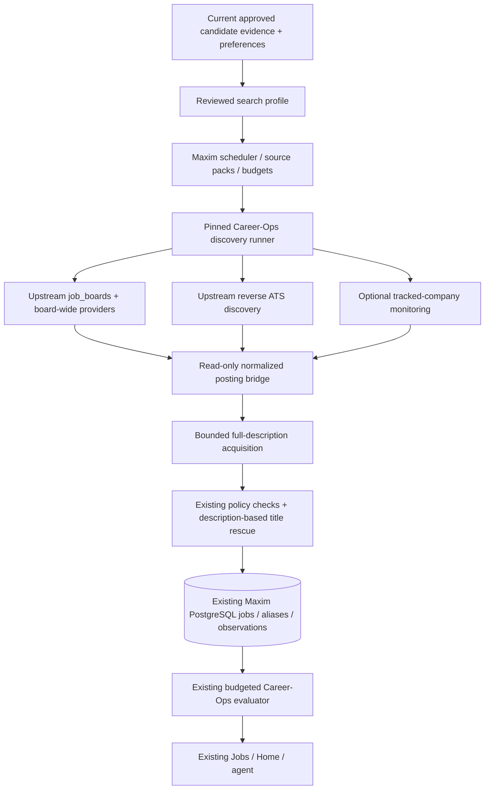

# Upstream-Native Discovery Design

Date: 2026-11-21. Status: proposal for owner review, not implemented.
This replaces the connector-pilot architecture proposed in
[the research report](source-discovery-research.md). Its source audit remains
useful; its proposal to start around one external market-index service is not
the basis of this design.

## 1. Decision

Adopt Career-Ops 1.40.0's **discovery subsystem** as Maxim's source engine.
Do not build another provider framework or make a commercial job-search API a
prerequisite. Integrate upstream's registry, board-wide sources, reverse ATS
discovery and useful filtering through a small read-only bridge.

Pin the inspected version to commit
`194933aa111aa4f2fd3ffa69048347fa6a974d27`. Keep the existing Career-Ops scoring,
PDFs, candidate authority, application lifecycle and Maxim workspace unchanged
unless a separately tested compatibility extension is necessary. This is not
authorization to merge all upstream changes or introduce another writable tracker.

The complete upstream provider catalog is in scope for integration and
classification. Do not redefine completion as importing only three providers.

> **Comments:** Refine the adoption boundary here.

## 2. Architecture

The runner receives public search criteria, not the private CV, database
credentials, application records or model key. Maxim owns scheduling and commits
validated results through existing services. Upstream does not write Maxim's
trackers, candidate files, reports or application projections.

Reuse provider implementations and their dependency contracts, not just their
names. Audit direct helper/network calls before activation. Trusted, pinned code
plus a scratch directory is not itself an operating-system sandbox: establish
and test the actual filesystem, network, resource and cancellation boundaries.
No untrusted web page may install a provider or supply an executable parser.

### Why A Bridge Is Necessary

Current upstream `scan.mjs --json` emits a receipt including counters and added
URLs, not full posting objects. `scan-ats-full.mjs --json` includes richer offer
metadata but not full descriptions. Neither receipt alone is a complete input
to Career-Ops evaluation.

Expose normalized provider results through a narrow result sink/adapter before
native persistence or lossy receipt serialization. Use a bounded stream of job
records with provenance and explicit description completeness. Retain upstream's
fetching, parsing and pagination. Add the smallest integration hook required;
do not scrape console output or turn native Markdown into a second job database.
Test dry-run and all write boundaries rather than assuming a command flag proves
isolation. Keep ordinary upstream use available under its existing authority gates.

> **Comments:** Add adapter and upstream-compatibility concerns here.

## 3. Scope Of Search If Implemented

There are three complementary search lanes. None requires manually listing every
employer before a discovered job is eligible for admission.

### A. Board-Wide Search

Use upstream `job_boards` entries and board-wide providers to retrieve jobs from
many employers in one source. Applicable examples in the inspected catalog:

| Source family | Examples | Search scope |
| --- | --- | --- |
| US technology and startups | Built In, Wellfound | Board searches/categories/locations across employers, not one company page |
| Startup communities and portfolios | Hacker News Who Is Hiring, a16z speedrun talent network | Available hiring posts/portfolio jobs across employers; normalize actual job links |
| Remote technology boards | Himalayas, Remotive, RemoteOK, Jobicy, Working Nomads, We Work Remotely | Board-wide inventories or searches, subject to US/NoVA eligibility and owner remote preferences |
| Other regional/specialist boards | Additional upstream modules selected from the complete catalog | Available when relevant to the chosen region/work family and allowed by source policy |

Some providers accept server-side queries; others return a feed which the scanner
filters locally. Report that distinction. A keyword accepted by a wrapper must
not be represented as a server-side description search if the board ignores it.

### B. Reverse ATS Discovery

Reuse upstream's directories/feed discovery for these nine ATS families:

1. Greenhouse
2. Lever
3. Ashby
4. Workday
5. iCIMS
6. BambooHR
7. Paylocity
8. join.com
9. Workable

This discovers employer boards from source inventories, then retrieves matching
postings. An employer absent from `portals.yml` can appear without a user adding
it. Underlying HTTP requests can still be per tenant; that is automated source
discovery, not a manually curated watchlist.

The directory is not a registry of every employer in existence. Record inventory
date, available/discovered tenants, scanned tenants, cursors, caps and failures.
Rotate a bounded inventory instead of starting at the same first tenants each
cycle. The existing curated employer list must not gate this lane.

### C. Optional Employer Monitoring

Retain specific employers for preferential monitoring, using their applicable
upstream providers. Modules for single-company sites and ATS products without a
reverse directory are useful here. They can also enrich employers discovered
through lanes A/B when a supported identity is verified.

Do not claim automatic tenant discovery for every ATS merely because a parser
for that ATS exists. Finding a board URL and being able to parse it are separate
capabilities.

### What The Number 153 Means

The release target includes the 153 inspected non-helper module files in a
pinned, classified registry. Each gets a declared source type, region/query
capabilities, description availability, permission requirements, limits and
health state. Local executable parsers require separate explicit approval.

It does **not** mean 153 global search engines, 153 sources active for Xavier,
or 153 successfully searched boards on every run. The registry mixes ATS
adapters, board-wide aggregators, single-company parsers, regional sources,
local-parser support and unavailable/retired integrations.

The source catalog must distinguish `available`, `enabled`, `verified`, `partial`,
`blocked`, `unconfigured` and `retired`. Audit and classify every module, but do
not execute irrelevant regional sources merely to inflate a coverage counter.
Use all validated sources relevant to a selected source pack, not a permanently
hardcoded three-provider allowlist.

> **Comments:** Add source packs or scope exclusions here.

## 4. What Jobs Maxim Searches For

Build a reviewed, versioned profile from approved evidence and explicit
preferences. Use the existing candidate authority and agent proposal boundaries;
do not create another CV or silently invent qualifications.

For the stated background, proposed starting work families are:

- Customer-facing software delivery: integrations, deployment, implementation,
  technical problem-solving and translating requirements into working software.
- Application/product engineering: applications, APIs and full-stack features.
- Automation/internal tooling: scripts, workflow improvement and connected systems.
- Systems/integration delivery where actual requirements match approved evidence.

Titles are aliases inside these families, not the complete definition of the
work. A Solutions Engineer may be a software builder or a sales role; a Systems
Engineer may be software integration or a different engineering discipline.
Responsibilities, required experience and candidate evidence decide which is
worth evaluation. Do not infer advanced tools, credentials, finished degrees or
active clearance from broad experience labels.

Generate upstream-compatible role/title aliases, content traits, categories,
locations and work-arrangement criteria. Plan generation occurs when evidence or
preferences change, not through a continuously running model agent. Preview and
approve the profile once; the ordinary scans use deterministic providers.

Keep the confirmed NoVA/DC, Maryland-default exclusion, salary and clearance
policies. Unknown or mixed locations need appropriate review. Remote opportunities
are not admitted just because a remote board returned them.

> **Comments:** Refine work families and responsibility groups here.

## 5. Closing Upstream's Title-Miss Gap

Use upstream's `content_filter.rescue_title_misses` behavior where implemented.
It can keep positive-title misses on description evidence; it is not semantic
understanding, and it needs usable text. Keep explainable responsibility/synonym
groups rather than matching generic words such as Git or engineer.

The reverse scanner currently ignores that option because its whole-board
precheck uses titles before acquiring descriptions. A narrow, tested change is
required; this limitation cannot be fixed by enabling a configuration flag.

Proposed behavior:

1. If list records contain descriptions, evaluate relevant content traits before
   discarding a board solely for title mismatch.
2. If a title-miss record lacks a description, reserve a bounded exploration quota
   for permitted detail retrieval, using geography/category evidence where present.
3. Run the same content-trait rule after enrichment. Preserve explicit owner
   exclusions, uncertainty and eligibility reasons.
4. When budget/cap prevents inspection, report `not inspected` or partial coverage,
   not `no relevant jobs`. Rotate unexplored records on later runs.

For board providers with title-only server search, use broader categories/location
passes as well as aliases. A role never returned by the source cannot be rescued
afterwards. This does not promise exhaustive description reading across the internet.

Rust is appropriate for bounded normalization, trait matching and eligibility
explanations. Reuse stable upstream provider code in JavaScript; a language rewrite
does not improve source coverage by itself. Do not change the Career-Ops 1.0-5.0
fit engine or present retrieval relevance as a second fit score.

> **Comments:** Supply examples of unconventional titles that must survive.

## 6. Default User Experience

The owner chooses **Broad market** as the strategy, work families, geography,
source pack and scan/scoring limits. Maxim generates board queries and reverse
discovery configuration. No hundreds-of-companies setup and no required ATS slugs.

An example request is: "Find hands-on integration, automation and software-delivery
roles around NoVA/DC, including titles I might not know." The agent proposes the
profile and settings; it cannot invent facts or approve spending itself.

Discovery shows actual search scope per run: board searches performed, catalog
coverage, unique employers, returned jobs, policy holds, missing descriptions and
which sources failed or were capped. Jobs/Home continue to use current Career-Ops
scores, not provider popularity or the number of matches returned.

The existing explicit all-scanned scoring mode remains available. Discovery
improvements do not silently narrow an owner's request to score their backlog.

> **Comments:** Adjust the user-facing controls and coverage language here.

## 7. Storage, Costs And Safety

- Reuse the existing worker, database, retention protections and default 200-active-
  lead cap. Streaming and cursors replace storing a copy of every board inventory.
- Zero LLM tokens for ordinary upstream fetch/parse does not mean zero network,
  disk or CPU cost. Cap time, requests, bytes, pages and concurrency per source/run.
- Retain compact historical records for admitted/archived jobs under existing
  rules, not an unlimited archive of every discarded market hit.
- The large Workable feed is a named resource-heavy path, not an automatic default.
  Enable only with a tested streaming/cache budget; otherwise label it deferred.
- Preserve source attribution, permitted application links, provenance and expiry
  obligations. Code license and job-data permission are separate checks.
- Respect rate limits and stop on authentication/challenges. Never add CAPTCHA
  solving, stealth, identity/proxy rotation or hidden LinkedIn automation.
- Unsupported or blocked is not empty. Do not promise unrestricted LinkedIn,
  Indeed, Glassdoor, Dice or hiring.cafe access from the upstream module count.
- No commercial search API is required by this design. Optional licensed search
  can be added later, but is not the core dependency or a substitute for adoption.
- Keep the owner's $5/day automatic-scoring limit and separate permissions. A
  source/profile change does not approve model spending, scans or cleanup.

> **Comments:** Add operational limits and rights requirements here.

## 8. Delivery And Completion Criteria

1. **Adopt the pinned discovery engine:** catalog all 153 module files, retain
   license/provenance, identify dependencies and test the read-only boundary.
2. **Integrate board-wide execution:** expose upstream `job_boards` through the
   existing worker/store and source packs, with per-provider capability/health.
   Do not stop at the old three feeds or require employer pre-registration.
3. **Integrate reverse discovery:** support the nine inventory/feed families,
   bounded rotation, real partial-result receipts and normalized opening identity.
4. **Add profile compilation and title-miss handling:** use responsibilities and
   evidence; implement/test the reverse-scanner gap rather than hiding it.
5. **Finish description and scoring flow:** incomplete records are enriched or
   held; accepted complete records use existing scoring, consent and cost gates.
6. **Prove scope in the dashboard/agent:** execute a controlled source-pack run
   and report real successes, failures, coverage, storage and high-fit yield.

Acceptance must prove an untracked employer is discovered without editing the
watchlist; an unexpected title survives on actual work; an attractive title with
an active-clearance requirement is not recommended for application; duplicate
publishers do not multiply openings; and stopped/capped scans remain resumable
without false completeness claims. Native tracker/projection checks, private data,
existing PDFs/scoring and manual submission boundaries must remain intact.

All 153 modules must be accounted for in the capability manifest. Only validated,
relevant, permitted sources are activated. Completion is not a claim that every
external website works today. No runtime integration is performed by this document.

> **Comments:** Approve scope or request changes before detailed stage planning.

## 9. Evidence And Remaining Decisions

Read-only source inspection verified the registry/catalog, `job_boards` execution,
reverse-discovery scope, title-rescue warning and structured CLI output limits.
No complete upstream sweep or 153-provider live benchmark was run. Site behavior,
per-source rights and NoVA/DC result quality still need explicit runtime proof.

- [Pinned upstream provider catalog](https://github.com/career-ops-hq/career-ops/blob/194933aa111aa4f2fd3ffa69048347fa6a974d27/docs/SUPPORTED_JOB_BOARDS.md)
- [Pinned scanner and its JSON receipt](https://github.com/career-ops-hq/career-ops/blob/194933aa111aa4f2fd3ffa69048347fa6a974d27/scan.mjs#L6505)
- [Reverse discovery scope](https://github.com/career-ops-hq/career-ops/blob/194933aa111aa4f2fd3ffa69048347fa6a974d27/scan-ats-full.mjs)
- [Reverse title-rescue limitation](https://github.com/career-ops-hq/career-ops/blob/194933aa111aa4f2fd3ffa69048347fa6a974d27/scan-ats-full.mjs#L1043)
- [Earlier source research and publisher constraints](source-discovery-research.md)

Detailed planning must settle bundle layout, exact output hook, child-process
permissions, source-pack defaults, remote inclusion and a justified large-feed
budget. These are implementation decisions within this upstream-native approach,
not reasons to replace it with a different commercial search service.

> **Comments:** Add remaining design questions or miscellaneous ideas here.
