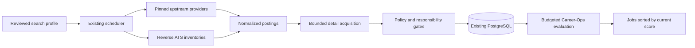

# Upstream-Native Discovery Roadmap

Approved direction: [design](../upstream-discovery-design.md). Started 2026-11-21.
This roadmap extends the existing workspace, worker and Career-Ops evaluator.
It does not replace candidate/application authority, scoring, PDFs or manual submission.

## Outcomes

Discover employers outside the watchlist; retain relevant unconventional titles;
acquire actual descriptions; rank using current Career-Ops evaluations; expose
honest source coverage and remain within the owner's $5/day scoring allowance.

## Stages

| Stage | Implementation and handoff | Acceptance evidence | Status |
| --- | --- | --- | --- |
| 1. Pinned engine | Vendor all 153 provider modules and necessary dependencies with source hashes/license; classify capabilities, direct-network and executable-parser restrictions. Read-only subprocess/result protocol, sanitized environment and bounded transport. | Four bridge tests passed; 153 providers, 195 pinned files, 2,606,123 bytes. Native public-peer validation reused in Stage 2. | Complete |
| 2. Board-wide execution | Integrated upstream providers with existing sources/runs/attempts, worker and store; US technology and optional remote source packs; compact provenance and public read transport. | Production build/typecheck and isolated board-wide integration passed: unknown employer, idempotence, workspace isolation, full JD, no secret headers, challenge/cooldown. UI follows in Stage 6. | Complete |
| 3. Reverse ATS | Extracted upstream inventory contracts for nine families without importing native writers. Eight bounded directory runners, 24-hour compact cache and persisted rotating tenant cursor. Workable global feed explicitly disabled/deferred. | Five bridge tests and isolated integration passed: a fifth unknown employer is found on the next window, one cached directory, honest partial coverage. Live probe in Stage 6. | Complete, Workable large feed deferred |
| 4. Search profile | Versioned owner-reviewed profiles with current evidence references, title aliases and responsibility groups. Rust screening runs on descriptions before title rejection in both search lanes; profile/candidate changes revoke stale runs. | 46 Rust tests, two profile unit tests, production build and extended isolated integration passed. Unexpected title rescued; clearance-required role remains blocked. Detail exploration completes in Stage 5. | Complete |
| 5. Description and scoring | Added bounded verified ATS/JSON-LD detail acquisition, rotating title-miss exploration, manual refresh and full-description scoring gates. Fixed formatting-only score conflicts; saved reports can be locally revalidated without model spend. | 48 Rust tests and three detail tests passed; isolated board/detail/rescue/evaluation integration passed. Local revalidation and summary-hold regression added; live proof follows in Stage 6. | Complete, final regression/live proof follows |
| 6. Experience and proof | Compact profile/experience-level/catalog/coverage controls; owner/agent review; corrected local-first scoring windows and full-evidence priority. | Full 145-test backend and 43-journey browser regressions; focused post-audit checks; live new employers, seniority holds and a current 4.0/T2 result. Exact evidence and external limits below. | Complete |

Each stage is a scoped commit. Stage boundaries may share interfaces; a stage is
not complete merely because a fixture or a populated catalog exists.

## Constraints And Decisions

- Pin `194933aa111aa4f2fd3ffa69048347fa6a974d27`; no wholesale upstream merge.
- Retain all 153 implementations, but do not activate restricted/retired/local-exec
  or unreviewed transports. Installed, enabled, tested and successful are separate.
- Reuse upstream provider parsing, not lossy scan receipt output or native writers.
- No private candidate context or API/database secrets in discovery subprocesses.
- Public read-only search POSTs are permitted only where the audited provider
  requires them. Never allow arbitrary browser actions or application submission.
- No source/profile change authorizes paid evaluation, cleanup or remote eligibility.
- Use existing default 200-lead capacity/protected history rules. The owner explicitly
  selected 600 and archival of 150 original unprotected records during execution.
  Do not silently delete
  the owner's existing over-capacity backlog to make a demonstration pass.
- Report partial coverage and skipped/uninspected records. No exhaustive-web claim.

## Verification Matrix

| Issue | Required proof |
| --- | --- |
| Employer-watchlist dependency | Board-wide and reverse fixtures admit a new employer without adding a company source. |
| Titles miss real work | A non-alias title with integration/automation responsibilities reaches evaluation; title-only similarity is not a fit score. |
| Incomplete job evidence | Teasers remain summaries until an authorized detail endpoint supplies the full JD. |
| Narrow/invisible coverage | UI/API distinguish provider catalog, enabled sources, actual requests, unique employers, failures and caps. |
| Duplicate publishers | Canonical ATS identity/URL aliases converge without fuzzy merging distinct job IDs. |
| Uncontrolled cost/storage | Budget reservations remain atomic; bytes/requests/deadlines/retention/capacity remain bounded. |
| Misleading ranking | Current Career-Ops scores sort first; stale, missing or failed scores remain explicit. |
| Unsafe regression | Native commands, tracker projections, PDF and manual-submit boundaries still pass. |

## Execution Record

Implementation and live/test results will be recorded in [verification](verification.md).
The subsequent [experience-level investigation](fit-audit.md) explains why the
initial sample lacked qualified matches, what was corrected, what remains
uncertain and how the newly approved target context changed a real evaluation.
External availability, source rights, credentials and owner approvals are not
simulated. Unavailable providers remain visible with the exact reason.
